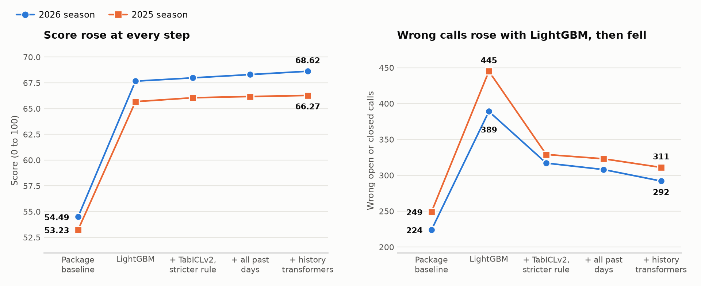
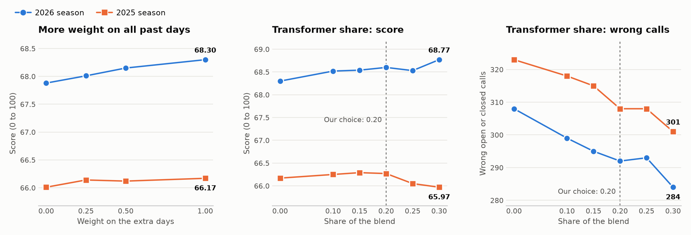

# Connect Suggests

Wrong holiday hours send customers to a closed door, and most owners never get round to logging in to fix them. So Connect does the noticing: it spots hours that are about to be wrong and sends the owner a ready-made suggestion with the reason. The owner taps once, with no login, and Connect writes the change to Yext and says where it will show.

All data is synthetic: "Connect Suggests simulator, Since AI ry 2026".

## At a glance

| | |
|---|---|
| **What it does** | Spots holiday hours that are about to be wrong, asks the owner in one tap, then writes the change to Yext and confirms it |
| **The AI** | A transformer blend: LightGBM (48%), TabICLv2 (32%) and our own history transformers (20%) |
| **Score on the organisers' `evaluate.py`** | **68.62** on 2026 and **66.27** on 2025, against the package baseline's 54.49 and 53.23 |
| **Trained on** | One gaming laptop with a 4 GB GPU |

The quickest way we check all of this, from a fresh clone:

```bash
git clone https://github.com/mahbub2649/fonecta_challenge.git
cd fonecta_challenge
python3 -m unittest discover tests
python3 fonecta_data/FONECTA_CONNECT_SUGGESTS_2026/evaluation/evaluate.py --predictions predictions_2026.csv
./run_webui.sh
```

## How we run it

### The laptop we use

All training and testing ran on this one machine:

| Part | What we have |
|---|---|
| Laptop | Acer Nitro AN515-57 |
| CPU | Intel Core i5-11400H, 6 cores and 12 threads |
| Memory | 14 GB usable, plus 4 GB of swap |
| GPU | NVIDIA GeForce RTX 3050 Ti Laptop, 4 GB |
| System | Ubuntu 26.04 LTS |
| Python | 3.14.4 |
| Libraries | LightGBM 4.7.0, scikit-learn 1.9.1, pandas 3.1.1, NumPy 2.5.4, PyTorch 2.15.0 with CUDA 13.2, TabICL 2.2.0, seaborn 0.13.2 |

The web app and tests don't use the GPU or any of those libraries. They use only Python's standard library, and are written for Python 3.9 or newer, so `requirements.txt` has nothing to install.

### 1. Getting the code

```bash
git clone https://github.com/mahbub2649/fonecta_challenge.git
cd fonecta_challenge
```

The challenge data package is already in `fonecta_data/`, so the app runs straight after cloning. For a copy kept somewhere else, we set `CONNECT_DATA_DIR` to its `FONECTA_CONNECT_SUGGESTS_2026` folder.

### 2. Starting the app

```bash
./run_webui.sh
```

This opens http://127.0.0.1:8080 in the browser, or the next free port if that one's busy, and `Ctrl+C` in the terminal stops it. `python3 run.py` works too, and `./run_webui.sh --no-browser` starts it without opening a browser.

By default, writes go to the local mock, and the top of the page shows which is active. To write to a real Yext sandbox as well, we copy the example settings, put the key in `.env`, and start with `--sandbox`:

```bash
cp .env.example .env
./run_webui.sh --sandbox
```

| Optional setting | What it does |
|---|---|
| `YEXT_API_KEY` | The Yext sandbox key, set in `.env` |
| `CONNECT_DATA_DIR` | Where the challenge package is, if not in `fonecta_data/` |
| `CONNECT_PORT` | Uses another port instead of 8080 |
| `CONNECT_HOST=0.0.0.0` and `CONNECT_PUBLIC_URL=http://<laptop-ip>:8080` | Opens owner links on a phone on the same network. The console stays on the laptop |

### 3. Walking through it on the web page

This is how we go through all five steps:

1. We choose **Kahvila Aurora** on the left, and **Run detection** looks for hours that may be wrong.
2. **Send by SMS** puts the message on the on-screen phone.
3. The link in the message opens the owner's page, where we approve or edit.
4. Steps 4 and 5 then fill in beside the phone, and the audit trail records each step.
5. **Detect the next dates** shows the next message using what the owner just said.

**Reset demo** starts again at any point.

### 4. Walking through it on the command line

With the app running, we drive the same chain from a second terminal through its local API. If the app started on another port, `B` changes to match.

```bash
B=http://127.0.0.1:8080
J='Content-Type: application/json'

curl -s -X POST -H "$J" -d '{}' $B/api/reset
curl -s -X POST -H "$J" -d '{}' $B/api/business/FI-D0001/detect    # detect and suggest
curl -s -X POST -H "$J" -d '{}' $B/api/case/1/send                 # contact: returns the message and owner link

T=$(curl -s $B/api/business/FI-D0001 | python3 -c "import json,sys;print(json.load(sys.stdin)['cases'][0]['token'])")
curl -s $B/api/o/$T                                                # the dates waiting for a decision

curl -s -X POST -H "$J" \
  -d '{"decisions":[{"item":1,"action":"edit","hours":"07:30-14:00"},{"item":2,"action":"approve"}]}' \
  $B/api/o/$T/decide                                               # decide, apply and confirm
```

### 5. Testing and scoring

We run the tests and score our predictions with these two commands. Neither needs anything installed:

```bash
python3 -m unittest discover tests
python3 fonecta_data/FONECTA_CONNECT_SUGGESTS_2026/evaluation/evaluate.py --predictions predictions_2026.csv
```

The tests report `Ran 35 tests` and `OK`, and the scorer reports `Score: 68.62 / 100` on the dev labels.

`predictions_2026.csv` also holds our predictions for every test and demo row, so the same scorer works on the hidden test by pointing it at those labels:

```bash
python3 fonecta_data/FONECTA_CONNECT_SUGGESTS_2026/evaluation/evaluate.py --predictions predictions_2026.csv --labels <path-to-hidden-labels.csv>
```

### 6. Rebuilding the model from scratch

The app doesn't need this, because the models' output is already in this repository. To reproduce it, we run these in order, in a fresh virtual environment. It needs a GPU with about 4 GB of memory for the neural models.

```bash
python3 -m venv .venv
source .venv/bin/activate
pip install -r model/requirements-neural.txt

# Data and the past-day estimator
python3 tools/build_views.py
python3 model/build_dataset.py
python3 model/past_days.py --before 2025-11-06
python3 model/past_days.py

# TabICLv2
python3 model/neural.py tabicl --max-train 16000 --tag _16k
python3 model/neural.py tabicl --max-train 16000 --strict --soft soft_strict.parquet --tag _16k_strict

# The two history transformers
python3 model/history_transformer.py --epochs 80 --patience 10 --d 128 --layers 4 --drop .3 --seeds 7,21 --tag _deep
python3 model/history_transformer.py --epochs 80 --patience 10 --d 128 --past-weight 1.0 --seeds 7,21 --tag _past
python3 model/history_transformer.py --epochs 80 --patience 10 --d 128 --layers 4 --drop .3 --seeds 7,21 --strict --tag _deep_strict
python3 model/history_transformer.py --epochs 80 --patience 10 --d 128 --past-weight 1.0 --seeds 7,21 --strict --tag _past_strict

# The final blend: prints every score, then overwrites predictions_2026.csv and connect/model_decisions.json
python3 model/blend.py --weight 0.4 --hist-weight 0.2 --closed-margin 0.2 --strict --write

# The customer messages and the charts in this README
python3 tools/export_messages.py
python3 tools/make_charts.py
```

We run these one at a time, because heavy jobs running together can run a laptop out of memory. On our laptop:

| Step | About how long |
|---|---|
| Data and past-day estimator | 5 minutes |
| TabICLv2, for all folds | 45 minutes, plus its strict run |
| Each history transformer | 15 to 20 minutes |
| Each strict history transformer | 9 minutes |
| Final blend | 4 minutes |

Neural training on a GPU isn't perfectly repeatable, so a full rebuild can differ slightly from our numbers. The checks in step 5 use the saved predictions, so those match exactly.

### Businesses we test with

| Business | What it shows |
|---|---|
| `FI-D0001` Kahvila Aurora | Fonecta's own example |
| `FI-D0017` Kahvila Kipinä | New customer with no history |
| `FI-D0004` Muoti Lyhty | Follows the shopping centre's hours |
| `FI-D0006` Kesäravintola Ranta | Summer terrace with a forgotten winter closure |
| `FI-D0002` Ravintola Kanerva | Normally closed on Sundays, but opens on Father's Day |
| `FI-D0012` Tilitoimisto Otso | Standing permission: applied, then informed, with undo |
| `FI-D0011` Pizzeria Torni | Closed for good: goes to a person, not the owner |
| `NO-D0015` Trening Nordlys 24/7 | Nothing to change: stays quiet |
| `SE-D0008` Kafé Linnea, `NO-D0009` Bakeri Fjord | Swedish and Norwegian |

## The five steps

1. **Detect:** estimates, for each special day to 6 January 2027, whether the business will be closed, as shown, or open at other hours.
2. **Suggest:** picks the most likely exact hours and keeps the reason. Above 90% confidence it states the suggestion, below that it asks, and for weak guesses it stays quiet.
3. **Contact:** one message per group of nearby dates, in the owner's language, on their preferred channel. Opt-outs block it. Delivery is simulated on an on-screen phone.
4. **Decide:** a private link opens a phone page to approve, edit or decline, with no login. Opening the link changes nothing, and no reply never counts as a yes.
5. **Apply:** merges the change into the full hours, writes it to the Yext sandbox and reads it back. Only then is the owner told it's saved and where it should show. If the write fails, they're told nothing changed.

## How the AI works

The model only proposes. Nothing is published without the owner's approval or standing permission.

1. **Review reader:** reads closed-door complaints, closing times, thanks for being open and new weekly hours, in Finnish, Swedish, Norwegian and English, and ties each statement to the day it's about.
2. **Past-day estimator:** most special days never got an entry, so what the business really did is hidden. A LightGBM model estimates it from what the day left behind: reviews, user edits, and spikes in calls and clicks.
3. **Open or closed model:** a transformer blend of three kinds of model, because they make different mistakes:

   | Model | What it does | Share |
   |---|---|---:|
   | LightGBM | Combines those estimates with history, peers, shopping centres, the 2025 pilot, events and weather. It learns from every past special day, not just November to January | 48% |
   | TabICLv2 | A transformer foundation model for tables | 32% |
   | History transformers | Our own two models, which read a business's past special days as a sequence, using the self-attention encoder from [Attention Is All You Need](https://arxiv.org/abs/1706.03762) | 20% |

4. **Hours picker:** builds candidate hours from every source and ranks them. The right hours are on the list 97% of the time.
5. **Decision layer:** chooses the action with the highest expected points, asks for extra proof before suggesting "closed", and holds back hours it thinks have under a 25% chance of being exactly right.

No business is ever scored by a model trained on it, and features only use data dated before the snapshot. The feature code has no path to the answer files, and we don't read the simulator's internals.

The models run ahead of time and their decisions are saved to a file, so the web app needs no machine-learning libraries. The research we considered, and what we tested from it, is in [REFERENCES.md](REFERENCES.md).

## How it learns

| Owner does | Next time |
|---|---|
| Edits the hours | Later suggestions move the same way, and that day uses their choice |
| Declines: "open as usual" | Connect stops asking about that day and needs more proof before suggesting "closed" |
| Declines: "stop" | The owner is opted out |
| Undoes a change | The earlier hours come back, and Connect stops asking about that day |
| Gives standing permission | Strong suggestions are applied, then the owner is told, with one-tap undo. Peer guesses are never applied this way |

## Results

We score everything with the organisers' `evaluate.py`, on businesses each model never saw. Differences under about 0.2 are within noise, so we only keep a change that beats that on both seasons, without doing worse in a stricter test. That test trains only on data from before the 2025 snapshot.

### How the score improved, step by step

Each row adds to the one above it, and the last row is the model in this repository.

| Step | What we added | Score, 2026 | Score, 2025 | Wrong calls, 2026 / 2025 | Stricter test: score | Stricter test: wrong calls |
|---:|---|---:|---:|---:|---:|---:|
| 1 | Package baseline, a rule ladder | 54.49 | 53.23 | 224 / 249 | | |
| 2 | LightGBM, with the review reader and past-day estimator | 67.66 | 65.67 | 389 / 445 | 59.41 | |
| 3 | TabICLv2 in a blend, and a stricter rule for suggesting "closed" | 67.98 | 66.05 | 317 / 329 | 60.30 | 554 |
| 4 | Training LightGBM on all past special days | 68.30 | 66.17 | 308 / 323 | 61.20 | 573 |
| **5** | **Two history transformers, at a 20% share** | **68.62** | **66.27** | **292 / 311** | **61.10** | **511** |



LightGBM made the biggest jump, and also made more wrong calls because it acts far more often. Every step after that raised the score and brought wrong calls down.

### How we chose the settings

All these rows use the blend with the stricter rule. They come from our experiment runs, which used a lighter setup than the final build, so their numbers differ slightly from the steps above.

**How much weight to give the extra training days:**

| Version | Score, 2026 | Score, 2025 | Wrong calls, 2026 / 2025 |
|---|---:|---:|---:|
| November to January only | 67.88 | 66.01 | 318 / 329 |
| All days, weight 0.25 | 68.01 | 66.14 | 314 / 325 |
| All days, weight 0.5 | 68.15 | 66.12 | 311 / 327 |
| **All days, weight 1.0 (our choice)** | **68.30** | **66.17** | **308 / 323** |
| All days, weight 0.5, with the hours picker trained on them too | 67.94 | 66.04 | 311 / 330 |

**How much of the blend to give the history transformers, with all past days included:**

| Transformer share | Score, 2026 | Score, 2025 | Wrong calls, 2026 / 2025 | Stricter test: score | Stricter test: wrong calls |
|---:|---:|---:|---:|---:|---:|
| 0.00 | 68.30 | 66.17 | 308 / 323 | 61.20 | 573 |
| 0.10 | 68.52 | 66.25 | 299 / 318 | 61.03 | 554 |
| 0.15 | 68.54 | 66.29 | 295 / 315 | 61.08 | 532 |
| **0.20 (our choice)** | **68.60** | **66.27** | **292 / 308** | **61.10** | **511** |
| 0.25 | 68.53 | 66.05 | 293 / 308 | 60.89 | 493 |
| 0.30 | 68.77 | 65.97 | 284 / 301 | 60.65 | 478 |



We chose 0.20 because it beats the earlier blend by more than the noise on both seasons, cuts more wrong calls than 0.15, and has the best score of the transformer mixes in the stricter test. Larger shares cut more wrong calls still, but they lose points on 2025. We chose it after trying 30 mixes, so its gain may be slightly flattering, but we fixed it before running the stricter test.

### The final model in full

| Measure | Package baseline | Earlier blend (step 3) | Final blend (step 5) |
|---|---:|---:|---:|
| **Score, 2026 season** | 54.49 | 67.98 | **68.62** |
| **Score, 2025 season** | 53.23 | 66.05 | **66.27** |
| Score, 2025, stricter test | | 60.30 | 61.10 |
| Exact recall, 2026 | 0.59 | 0.75 | 0.75 |
| Exact precision, 2026 | 0.90 | 0.86 | 0.87 |
| Search views protected, 2026 | 57.2% | 73.6% | 73.7% |
| Closed-door views prevented, 2026 | 69.2% | 84.5% | 84.8% |
| Wrong open or closed calls, 2026 | 224 | 317 | 292 |
| Wrong open or closed calls, 2025 | 249 | 329 | 311 |
| Wrong calls, stricter test | | 554 | 511 |

We still make more wrong calls than the baseline, because we catch far more wrong hours and the scorer rewards the trade. The owner sees each one with its reason before anything changes, and low-confidence suggestions are worded as questions.

These are scores on synthetic data, and the owner simulator isn't real customer behaviour.

## Data sources that mattered most

| Signal | How we used it | Where Connect would get it in production |
|---|---|---|
| Exception-hour history | The strongest evidence, and the main source of suggested hours | Connect's audit log |
| Customer reviews | Past closures, exact closing times and new weekly hours | Yext Reviews |
| Calls and clicks | Traces of days when the listing was wrong | Yext Analytics |
| Peer benchmarks | The main evidence for a customer with no history | Connect's own anonymised data |
| Shopping-centre hours | Businesses that follow their centre | Yext Knowledge Graph, centre entities |

## What we tried that didn't work

- **A second pass of the past-day estimator**, letting each day read the business's other days. It made both seasons worse, by up to 1.5 points on 2025.
- **Rating-only reviews and calls on neighbouring days.** They added nothing.
- **Averaging more random seeds, and a general decision margin.** Differences stayed within noise. A margin on "closed" alone, with the blend, is what cut wrong calls.
- **Larger, more detailed trees.** They scored worse on both seasons, and simpler trees did better.
- **Training the hours picker on the 2024 season.** It has too little history behind it, so that season is left out of the picker.
- **RealMLP, a neural model.** It was clearly weaker than LightGBM on one fold, and made the blend worse.
- **The history transformer without the extra training days.** It cut wrong calls, but lowered the strict 2025 score to 59.74, so it only earned its place alongside all past days.
- **Training the hours picker on all past days too.** It scored worse than training only the open or closed model on them.
- **Row weighting, pseudo-labels and a hidden-habit model across years.** No clear gain.
- **Similar businesses in the same city, and reviews dated on the holiday.** No gain, which suggests this dataset doesn't reward location.
- **Outside data.** All 88 live holidays from Nager.Date are already in the package's calendar, and real city population and daylight gave no clear gain. The hidden answers are synthetic, so outside sources can't predict them.
- **Prompting every low-data business.** It lowers the score (66.89 on 2026 at best), though a single question per business could still help real owners.
- **A small language model reading reviews.** We sized it first: even a perfect reader of all unread reviews added only about 1 point on 2026, so we didn't train it.
- **Norwegian test businesses in the sandbox.** Yext refuses them with `PROFILE_LANGUAGE_INELIGIBLE`, so that test record uses `en`. The owner's message is still Norwegian.

With perfect knowledge of last year's hidden behaviour, the same model reaches about 86 on 2026. We measured that on dev answers only, and it shows where the next gains are: better records of what businesses really did.

The review reader is built on the wording in this synthetic data. Real reviews are messier, so production would need a language model for this step, with code checking its output.

## Customer with no history

`FI-D0017` Kahvila Kipinä joined in October 2026. With no history of its own, the model leans on similar businesses. Connect says it has no earlier hours for them and asks instead of stating, and standing permission never applies a guess like this. On the other 10 days it stays quiet. Once the owner answers, later suggestions use that answer.

## Final customer messages

All of them, in every language, are in [docs/final_messages.md](docs/final_messages.md). The first message looks like this:

```text
Hei Aleksi! Kahvila Aurora näkyy Googlessa näinä päivinä todennäköisesti väärin:
• Jouluaatto to 24.12.: Google näyttää 7.30–18. Ehdotamme: 7.30–13. Viime vuonna: 7.30–13.
• Joulupäivä pe 25.12.: Google näyttää 7.30–18. Ehdotamme: kiinni. Viime vuonna: kiinni.
Emme ole tästä täysin varmoja, joten kerrothan, pitääkö ehdotus paikkansa.
Samoina päivinä viime vuonna yrityksellänne oli noin 43 hakunäyttöä Googlessa.
Hyväksy, muokkaa tai kieltäydy ilman kirjautumista: <link>
```

## Bonus: live source

Not attempted.

## What's real and what's simulated

| Part | Status |
|---|---|
| Sandbox write and read-back | Real, on labelled `TEST` businesses we create |
| Model, approval page, decisions, learning, audit trail | Real |
| Message delivery | Simulated, on the on-screen phone |
| Publisher timing in the confirmation | From the package's simulated listings, because the sandbox has none |
| Business history | The package's local Yext mock, because the sandbox has none |

## Extensibility

The loop isn't specific to hours: notice something, suggest it with a reason, get one tap, write it, confirm it, learn. Review replies and automatic posts fit the same flow. Each needs its own detection and wording, and reuses the approval page, standing permission, audit trail and undo.

## Third-party code, data and licences

| Component | Licence |
|---|---|
| Python standard library | PSF License |
| Challenge package: `mock_api`, run unmodified | MIT, © 2026 Since AI ry |
| Rule ladder in `connect/engine.py` and client in `connect/yext.py`, adapted from the package's `examples/` | MIT, © 2026 Since AI ry |
| Challenge data, including derived `connect/views.json`, `connect/model_decisions.json` and `predictions_2026.csv` | CC BY 4.0, "Connect Suggests simulator, Since AI ry 2026" |
| `model/` and `tools/build_views.py` only: LightGBM | MIT |
| `model/` and `tools/build_views.py` only: scikit-learn, pandas, NumPy | BSD-3-Clause |
| `model/` and `tools/build_views.py` only: PyArrow | Apache-2.0 |
| `model/neural.py` only: TabICL and its model weights | BSD-3-Clause |
| `model/neural.py` and `model/history_transformer.py` only: PyTorch | BSD-style, with Apache-2.0 parts |
| `model/neural.py` only: pytabkit, for the RealMLP test | Apache-2.0 |
| `tools/make_charts.py` only: seaborn | BSD-3-Clause |
| `tools/make_charts.py` only: Matplotlib | Matplotlib License, BSD-style |

The web app runs on the Python standard library alone. No GPL or AGPL components. No code from before the event is used.
